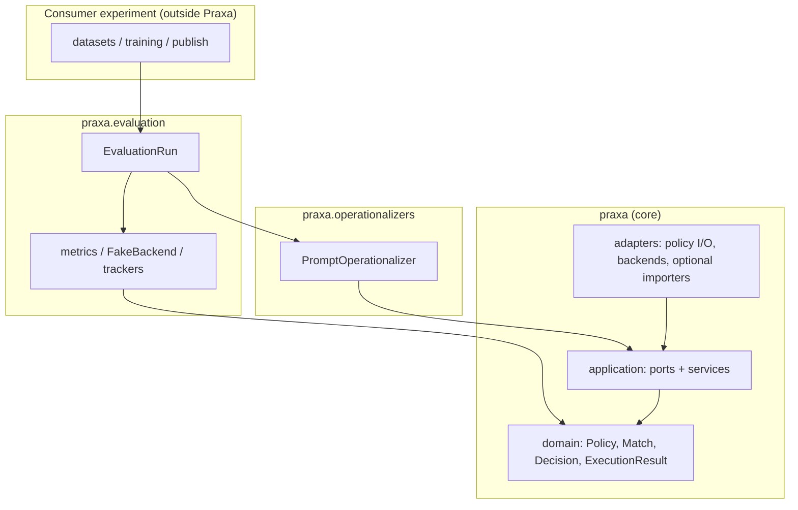
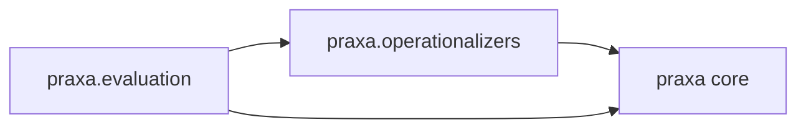
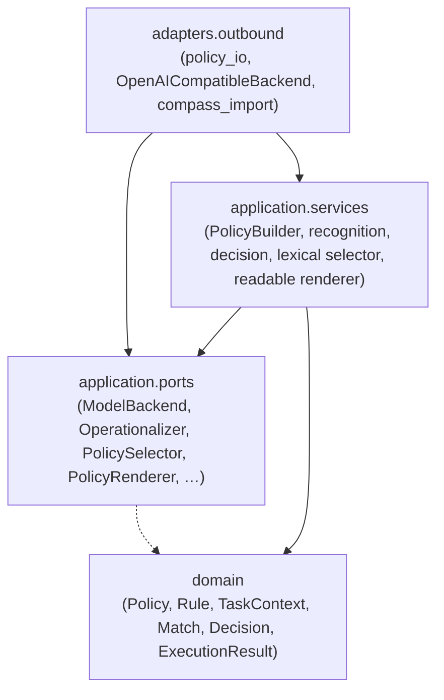
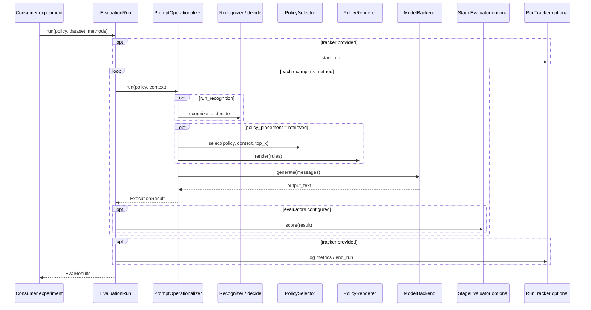
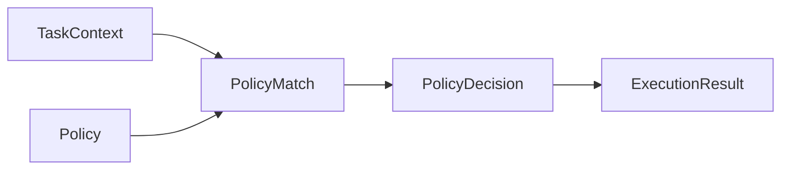

# Praxa architecture

## Three packages

| Package | Role |
|---------|------|
| **`praxa`** (core) | Schema and contracts: Policy, Match, Decision, ExecutionResult, ports, PolicyBuilder, policy I/O |
| **`praxa.operationalizers`** | Methods that *try* to make a policy work on a task |
| **`praxa.evaluation`** | Harness, metrics, FakeBackend, **RunTracker** (Null / MLflow) |



```python
from praxa import PolicyBuilder, TaskContext
from praxa.operationalizers import PromptOperationalizer
from praxa.evaluation import EvaluationRun, FakeBackend, load_mlflow_tracker

run = EvaluationRun(
    policy=policy,
    dataset=dataset,
    methods=[
        PromptOperationalizer.base(FakeBackend()),
        PromptOperationalizer.retrieved(FakeBackend(), top_k=3),
        PromptOperationalizer.full_policy_system(FakeBackend()),
    ],
    tracker=load_mlflow_tracker(experiment="my-study"),
)
results = run.run()
```

Optional MLflow tracking (default tracker is a no-op):

```bash
# preferred (this repo / uv projects)
uv sync --extra mlflow
# or, from a consumer project that depends on Praxa:
uv add 'praxa[mlflow]'

# pip alternative
pip install 'praxa[mlflow]'
```

Dependency direction (imports only point inward / downward):



Consumer **experiments** sit outside the library and wire all three.

## Core layering

Inside core, layout follows ports-and-adapters:



## Compositional prompting

`PromptOperationalizer` is the primary method class. Configurations cover the
usual prompt ladder without separate condition classes:

| Factory | Placement | Role |
|---------|-----------|------|
| `.base()` | none | System + query |
| `.full_policy_system()` | system JSON | Full policy in system (alias: `ContextPromptOperationalizer`) |
| `.full_policy_user()` | user JSON | Full policy under `# Company Policies` in the user turn |
| `.retrieved()` | selected clauses | `PolicySelector` + `PolicyRenderer` (defaults: `lexical_v1`, `readable_v1`) |
| `.few_shot()` | none + demos | Injected `(query, response)` pairs |
| `.decision_only()` | retrieved + contract | Short ANSWER/REFUSE-style decision reply |

Selection and rendering are ports. Defaults operate on `Policy.rules` (clause
text from `rule.metadata["clause_text"]` when present).

## Operationalizers

An operationalizer is a method under test: `Policy + TaskContext → ExecutionResult`.
It is not an evaluator and not core schema. Evaluation runs compare operationalizers.

## Evaluation

`EvaluationRun` scores operationalizers on a dataset. Metrics and test doubles live
here so research repos do not reimplement the harness. Binary compliance
(`BinaryComplianceEvaluator`, `aggregate_binary_compliance`) maps dispositions to
labels via an injectable table (default allow→answer, deny/restrict/redirect→refuse).

### Proposed evaluation sequence

The diagram below is the harness path when you use `EvaluationRun` with optional
scoring and tracking. Stage evaluators and a `RunTracker` are not required; the
default tracker is a no-op, and `evaluators` may be empty. Consumers can also
call an operationalizer directly and skip the harness.



## Optional adapters

- `OpenAICompatibleBackend` — stdlib `/chat/completions` client
- `compass_to_praxa` / `praxa_to_compass` — thin allowlist/denylist JSON mapper (optional format helper; corpora stay in consumer repos)

## Pipeline schema (core)



Recognition produces a match; decision aggregates dispositions; the operationalizer
produces the execution artifact the harness scores.
